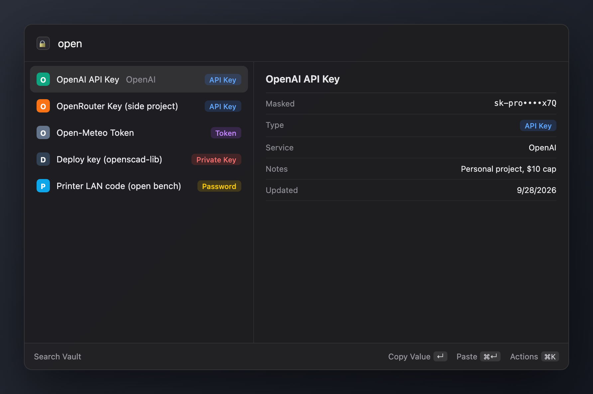

# Vault

A Raycast extension that saves and finds API keys and passwords in a Notion database.



*A mock of the Raycast list built in HTML with fake entries. Raycast's panel can't be screenshotted on my machine.*

I was keeping API keys in Google Keep and flipping back and forth every time I needed one. Now it's a hotkey: Add Secret to save one, Search Vault to copy or paste it, and the data sits in a Notion database I already had open anyway.

Vault is a convenience tool. Values are stored as plain text in Notion, so anyone (or any integration) with access to that database can read them. Keep your bank logins in a real password manager.

## Commands

| Command | What it does |
|---|---|
| **Add Secret** | Form with Name, Value, Type, Service and Notes. Value is prefilled from the clipboard. Type and Service are guessed from the name and the key's prefix (`sk-ant-` is Anthropic, `ghp_` is GitHub, `AIza` is Google, and about a dozen more). |
| **Search Vault** | Every entry, newest edit first, with a masked value in the detail pane. ↵ copies the value (marked concealed, so clipboard managers skip it), ⌘↵ pastes it into the frontmost app, ⌘⇧N copies the name, ⌘E edits, ⌃X deletes. |
| **Bulk Add** | Paste a pile of text with many keys in it (I used a Google Keep search page, copied whole). It finds the values, names each from the nearest title line, shows a preview, and skips anything already in the Vault by name or value. |

Delete archives the Notion page, so it goes to Notion's trash and can be restored from there.

## How it works

```
Raycast  -->  @notionhq/client  -->  Notion API  -->  your "Secrets" database
```

There's no server and no local copy. Every list loads straight from the database (cached by Raycast between opens), and every add or edit is one `pages.create` or `pages.update` call. Values longer than 2,000 characters, like a PEM private key, are split across several rich text chunks because that's Notion's per-chunk limit.

## Setup

### 1. Make the database

Create a Notion database (I called it "Secrets") with exactly these properties:

| Property | Notion type | Notes |
|---|---|---|
| `Name` | Title | Required |
| `Value` | Text | Required. The secret itself. |
| `Type` | Select | Options: `API Key`, `Token`, `Password`, `Private Key`, `Personal`, `Payment`, `Other` |
| `Service` | Text | Optional, e.g. `OpenAI` |
| `Notes` | Text | Optional |

The names are case-sensitive. The "Updated" date in the detail pane comes from the page's own last-edited time, so it needs no property.

### 2. Make an integration

1. Go to [notion.so/profile/integrations](https://www.notion.so/profile/integrations) and create an internal integration. Copy its secret (it starts with `ntn_`).
2. Open the database in Notion, then ••• → Connections → add your integration.
3. Copy the database ID: it's the 32-character string in the database URL, before `?v=`.

### 3. Install the extension

```bash
npm install
npm run dev
```

`npm run dev` runs `ray develop`, which installs the extension into Raycast in developer mode. Raycast asks for the two preferences the first time you open a command:

| Preference | Value |
|---|---|
| Notion Integration Token | the `ntn_...` secret from step 2 |
| Vault Database ID | the 32-character ID from step 2 |

Both live in Raycast's preferences store; nothing is hardcoded in the repo.

## What's rough

- Plain text in Notion. Fine for dev keys; keep anything that would hurt to leak somewhere else.
- The type and service guesses are regexes. They get the common providers right and leave the rest blank.
- Bulk Add's parser was tuned on the way Google Keep lays out a copied page. Other formats work if each key sits on its own line near a line that names it.
- Not in the Raycast Store, so it runs through `ray develop`.
